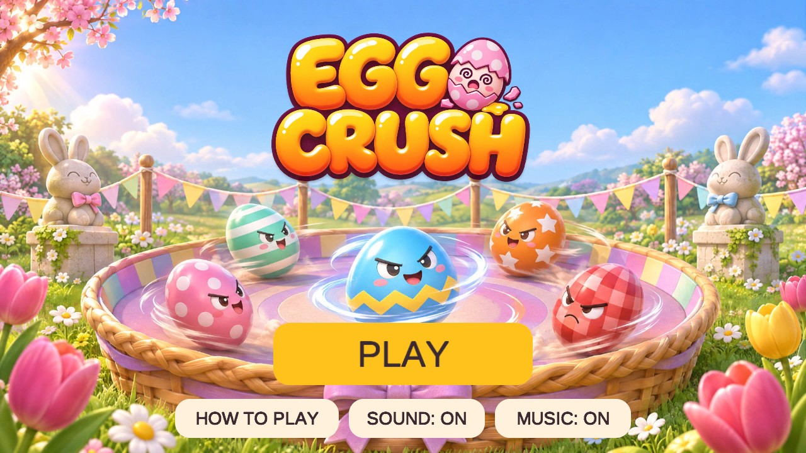
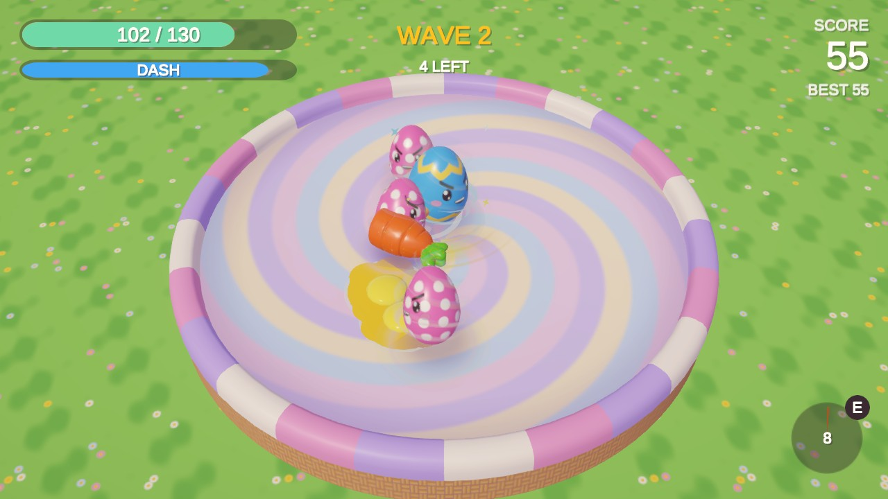
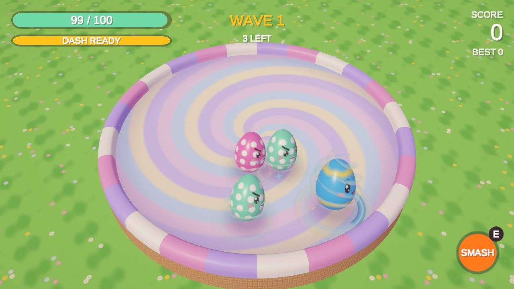

# Egg Crush

A cute game where painted Easter eggs spin like tops in a bowl arena and smash into each other. Crush every egg in the wave, pick an upgrade, and see how many waves you can survive.

## [Play it in your browser](https://musabasli.github.io/egg-crush/)

It runs on a computer and on a phone, with nothing to install.

- **Windows:** [download the latest release](https://github.com/musabasli/egg-crush/releases/latest), unzip it and run `EggCrush.exe`.
- **iPhone:** open the link in Safari, tap Share, then "Add to Home Screen". The game then starts full screen from its own icon.

## How to play

| Action | Keyboard | Touch |
|---|---|---|
| Move | W A S D (the arrow keys work too) | Drag anywhere: a stick appears under your finger |
| Dash | Space or left click | DASH button, a quick tap, or a tap with another finger |
| Carrot Smash | E or right click | SMASH button |
| Pause | Esc or P | PAUSE button |

- Ram enemy eggs to crack their shells. The egg that brings more speed into a hit deals more damage and takes less.
- Your egg looks where you last steered, and a blue arc on the floor shows that side. An egg that hits you inside the arc only does half damage, so face what is coming at you.
- Slam an enemy into the rim to hurt it more. An egg you launch also damages the eggs it flies into.
- The Carrot Smash swings a giant carrot hammer in a full circle around you. It recharges in 8 seconds.
- After each wave you pick 1 of 3 upgrades. When your own shell breaks the run is over, and your best score is saved.

Made with Unity by musabasli.
